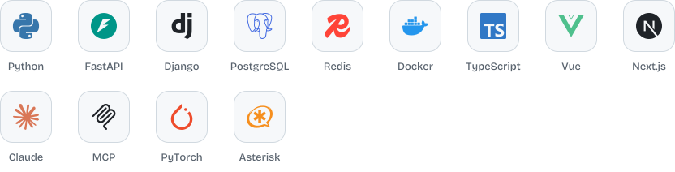

<picture>
  <source media="(prefers-color-scheme: dark)" srcset="assets/header-dark.svg">
  
</picture>

 

I turn noisy, real-world signals into AI that works in production: voice agents that pick up the phone, models that score credit and catch fraud, copilots that build a store from an idea. Most of it is built for Africa first, where data is scarce, the phone call matters more than the app, and a demo is never enough.

### Building

**[PropulsAI](https://www.propulsai.com)** is my company. We design, ship and run AI for banks, microfinance institutions and enterprises across Africa: fraud detection, credit-risk scoring, and voice agents that handle collection calls.

**[Trackira](https://www.trackira.ai)** is e-commerce intelligence with a multi-agent copilot. It tracks winning products, ads and competitors, then turns a product idea into a Shopify store ready to publish.

**[Bara](https://barajob.com)** is an AI recruiting platform: CV generation, candidate ranking and job matching.

### Open source

Small tools I use every day, shared.

- **[lws-mcp](https://github.com/NKSTUD/lws-mcp)** manages LWS domains, DNS and hosting from Claude, Cursor or any MCP client.
- **[macsweep](https://github.com/NKSTUD/macsweep)** frees up space on a Mac, from a local app or through any AI assistant.
- **[billing-e2e](https://github.com/NKSTUD/billing-e2e)** tests Stripe subscriptions end to end: renewals, failed payments, proration and cancellations.

### Research

Two papers with Lund University on using LLMs for engineering risk analysis, published by Cambridge University Press:

- [Integrating LLMs with RAG to Enhance Design FMEA](https://doi.org/10.1017/pds.2024.204), DESIGN 2024. Top 3 Best Paper.
- [AI-driven FMEA: Integration of LLMs for Faster and More Accurate Risk Analysis](https://doi.org/10.1017/dsj.2025.7), Design Science, 2025.

Before that, real-time fault diagnosis for high-speed train bearings from vibration and acoustic signals, with Morocco's national railway. I also teach AI and robotics at École Centrale Casablanca.

### Stack

<picture>
  <source media="(prefers-color-scheme: dark)" srcset="assets/stack-dark.svg">
  
</picture>

Also: OpenAI Agents SDK, RAG with pgvector, real-time speech pipelines, SIP telephony.

 

[propulsai.com](https://www.propulsai.com) &nbsp;&nbsp; [LinkedIn](https://www.linkedin.com/in/nouhan-kourouma)
